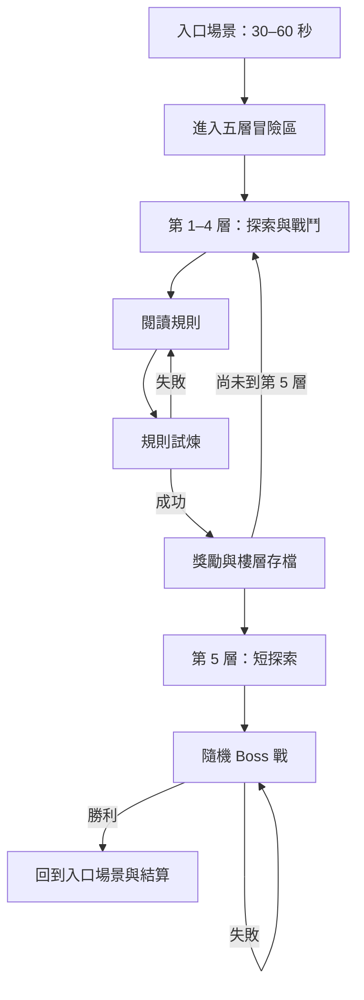

# Coji and the Castle Below：遊戲企劃 v0.3

> 中文暫名：**Coji 與地底城堡**
> 英文暫名：**Coji and the Castle Below**
> 資料夾代號：`castle-below`
> 狀態：企劃討論中，尚未進入實作

相關企劃檔案：[`TRIAL_RULES.md`](TRIAL_RULES.md)（72 組英文關卡規則）、[`gameplay-demo.html`](gameplay-demo.html)（2.5D 移動與戰鬥原型）

---

## 1. 遊戲概念

這是一款以 iPad 為主要平台、固定斜角視角、節奏明快的動作冒險遊戲。玩家從一座仍有燈火的小村莊出發，進入村外的廢棄城堡，一層層向地下探索。城堡共有 5 層：前 4 層必須通過一個「讀懂英文規則才容易成功」的試煉，第 5 層則以隨機出現的大魔王戰作為高潮。

表層上，它是一款略帶恐怖感、能戰鬥、能閃避陷阱、最後能打倒巨大怪物的冒險遊戲；深層上，它讓孩子為了順利過關，自然地主動閱讀簡短英文句子。

本作不追求大型世界、長篇任務或角色養成。每一次遊戲都必須是一段短而完整的冒險。

### 核心賣點

1. **短時間內有完整起承轉合**：離開村莊、深入城堡、通過試煉、打倒 Boss、凱旋回村。
2. **閱讀真的會改變玩法**：同一個房間每次可能有不同規則，只看畫面或背答案並不可靠。
3. **操作簡單但畫面刺激**：點地移動、點敵人發射魔法光球、按住角色原地防禦；危險都有清楚預兆。
4. **固定視角換取更精緻的視覺**：採用 2D／2.5D 的優勢，呈現比 Sunny Island 更寫實、陰暗、細緻的場景。
5. **每次重玩有變化但不拖長**：試煉規則、房間組合、少量敵人與最終 Boss 可以更換，總遊戲時間仍固定。

---

## 2. 目標玩家與平台

- 主要玩家：6–8 歲、已有基礎英文閱讀能力的孩子。
- 英文基準：以小學一年級可理解的常見字彙與句型為主。
- 主要平台：iPad Safari／加入主畫面的 Web App。
- 次要平台：桌面版 Safari、Chrome、Edge。
- 主要方向：橫向遊玩；直向時顯示簡單的旋轉裝置提示。
- 操作方式：觸控優先，滑鼠可以完整遊玩；不要求鍵盤。
- 氣氛：驚悚、刺激、神祕，略帶恐怖，但不血腥、不獵奇、不使用突然貼臉的驚嚇畫面。

### 主角：魔法師 Coji

- 主角確定為 Coji，不提供自訂角色或職業選擇。
- Coji 穿著康橋運動服：米白與深藍條紋上衣、深藍短褲、白襪與深藍運動鞋。
- Coji 仍然用雙手抱著被被熊；被被熊的布料會在移動、施法與防禦時有清楚擺動。
- 頭上戴一頂小型魔法帽。帽子不能太高或遮住臉，建議使用深藍色軟帽、金色星星與略微歪向一側的帽尖。
- 普通光球由 Coji 身旁短暫浮起的魔法符文發射，避免雙手抱著被被熊卻突然放手造成視覺不連續。
- 強力光球會先在帽尖或被被熊前方聚集，再高速射出，讓它和普通攻擊有明顯力量差距。
- 防禦時 Coji 抱緊被被熊、壓低身體，帽子向後擺動，外圍形成完整的圓形魔法防護罩。

---

## 3. 遊戲時間與節奏限制

### 目標時間

| 情況 | 目標時間 |
|---|---:|
| 第一次完整破關 | 15–20 分鐘 |
| 熟悉後再次遊玩 | 10–15 分鐘 |
| 單一樓層 | 2.5–3.5 分鐘 |
| 最終 Boss | 3–4 分鐘 |
| 不含暫停的時間上限 | 約 22 分鐘 |

若測試時大多數孩子超過 22 分鐘，應優先刪減走路距離、房間數量與敵人血量，不能用倒數計時逼孩子加快閱讀。

### 可中斷性

- 完成每一層後立刻自動存檔。
- 關閉分頁或離開遊戲後，下次可以從最近完成的樓層繼續。
- 每一層都是一個短小完整段落，孩子大約每 3–4 分鐘就有安全停止點。
- 「重新開始一場冒險」才會重新抽取關卡規則與 Boss；一般續玩不會改變當前內容。

### 明確不做的內容

為了避免規模再次失控，本作不加入：

- 開放世界與自由旋轉鏡頭。
- 支線任務、工作、商店經濟、飢餓／口渴等生存系統。
- 大型背包、裝備數值比較、素材收集與製作。
- 需要反覆刷怪或升級才能通關的成長系統。
- 每層大型迷宮、找不到出口的探索，以及長距離折返。
- 失敗後從村莊或第一層全部重來的懲罰。
- 為了延長遊戲時間而加入的每日任務、登入獎勵或重複勞動。

---

## 4. 一場遊戲的完整流程

### 入口場景的功能

入口場景是冒險前的安全區與情緒對比，不是另一個可長時間遊玩的開放世界。首個城堡主題使用村莊，另外兩套主題則分別使用暴風港與雪原研究站。

- 畫面溫暖、有燈火、村民關上門窗，遠處可以看見被雷雲籠罩的城堡。
- 第一次遊玩時，以 20–30 秒完成移動、光球攻擊與按住角色防禦的教學。
- 玩家走到城門前，閱讀一句簡短的故事目標，例如：`The castle bell woke the monsters.`
- 再次遊玩時可以略過教學，直接點擊城堡入口。
- 不設商店、接任務流程或需要整理裝備的準備階段。

### 每層的固定節奏

1. 進入一個視覺主題明確、面積小的探索區。
2. 遭遇 1–2 組敵人，或一個很短的環境危險。
3. 找到通往試煉房的門；路線保持清楚，不做迷路型迷宮。
4. 門前顯示本次規則卡，玩家閱讀後按下 **I AM READY**。
5. 通過試煉，獲得一個立即有感的祝福。
6. 下一層入口開啟，自動存檔，進入下一層。

---

## 5. 五層內容規劃

前四層各有一個閱讀試煉；第五層不再測驗閱讀，讓最後高潮專注在 Boss 戰。

| 區域 | 主題與情緒 | 一般玩法 | 關卡目的 | 目標時間 |
|---|---|---|---|---:|
| 村莊 | 溫暖燈火、遠方雷雨、不安但安全 | 快速教學、進入城堡 | 建立目標與操作 | 0.5–1 分 |
| 第 1 層：遺忘大廳 | 破敗宴會廳、熄滅壁爐、盔甲偶爾轉頭 | 2–3 隻慢速敵人 | 最簡單的單句規則 | 2.5–3 分 |
| 第 2 層：地牢 | 潮濕石牆、鐵門、遠處腳步聲 | 小群敵人、地面危險 | 加入順序或位置字 | 2.5–3.5 分 |
| 第 3 層：禁書庫 | 高書架、漂浮紙張、藍色鬼火 | 遠距敵人、移動掩體 | 兩句相關規則 | 3–3.5 分 |
| 第 4 層：祭壇深處 | 巨大雕像、紅色裂光、低沉鐘聲 | 精英敵人一隻 | 否定句或條件句，但仍使用常見字 | 3–3.5 分 |
| 第 5 層：王座裂谷 | 城堡最深處、破裂王座、地下雷雲或岩漿 | 30–45 秒短路段 | 進入隨機 Boss 戰 | 3.5–4.5 分 |
| 結尾 | 天亮、村民迎接、Boss 戰利品展示 | 簡短結算 | 完整成就感 | 0.5–1 分 |

樓層主題固定，能讓孩子感覺自己越走越深；房間內的小布局、敵人組合、試煉模板和規則內容可以更換。

### 三套可替換的完整冒險場景

這三套不是單純替換入口背景，而是三個共享操作與閱讀系統的完整主題包。每套都有自己的入口、五層環境、敵人造型、危險特效、音樂與 Boss。孩子選擇不同主題時，視覺與故事感受應接近在玩不同遊戲；開發上則可以共用移動、光球、防禦、試煉與存檔系統。

#### 場景 A：夜村與廢棄城堡（首個製作主題）

- **入口**：暴風雨前的夜村。屋內有暖光，村民緊閉門窗，山上的城堡傳來鐘聲。
- **五層**：遺忘大廳 → 地牢 → 禁書庫 → 祭壇深處 → 王座裂谷。
- **敵人**：骷髏守衛、蝙蝠、鬼火、盔甲騎士。
- **Boss**：雷焰惡龍、骸骨國王、沼影女巫。
- **獨特感受**：中古奇幻、鬧鬼城堡、火把與雷雨；三套中最接近 Diablo 一代的氛圍。

#### 場景 B：暴風港與幽靈船

- **入口**：無人暴風港。船隻互相撞擊，燈塔熄滅，一艘不應存在的巨大黑船靠岸。
- **五層**：暴雨甲板 → 船員艙 → 幽靈餐廳 → 淹水貨艙 → 深海祭壇。
- **敵人**：幽靈水手、會撲人的寶箱蟹、飛行水母、被海草纏住的船長盔甲。
- **Boss 候選**：深海巨妖、幽靈船長、燈籠鮟鱇怪。
- **獨特機制**：海浪短暫推動角色、積水反射閃電、船身傾斜讓危險區改變；不能改變基本操作或增加暈船式鏡頭晃動。
- **試煉外觀**：岩漿長廊變成跨越淹水甲板；封印門變成船艙門；守衛雕像變成幽靈船員。
- **獨特感受**：海上恐怖、暴風、木船嘎吱聲與深海巨大生物，和城堡的石造空間有明顯差異。

#### 場景 C：雪原基地與墜落星艦

- **入口**：極夜雪原研究站。基地只剩緊急紅燈，雪地中央露出墜毀星艦的入口。
- **五層**：冰封貨艙 → 黑暗生物實驗室 → 無光管線 → 失控反應爐 → 星艦艦橋。
- **敵人**：小型巡邏機器、爬牆異星蟲、漂浮探測眼、失控工程機甲。
- **Boss 候選**：異星女王、失控戰爭機器、吞光巨獸。
- **獨特機制**：門禁雷射、暫時停電、反應爐脈衝；魔法光球在這套場景中改畫成能量彈，強力光球則是高能核心。
- **試煉外觀**：岩漿長廊變成反應爐通道；魔眼變成監視鏡頭；封印門變成三道氣閘門。
- **獨特感受**：科幻驚悚、冰雪、機械與異星生命，視覺上最像另一款遊戲，但玩法仍不必重新學習。

三套場景應分階段製作：先把村莊與城堡完成並驗證玩法，再新增幽靈船，最後新增星艦。不能為了首版同時製作三套而降低每套的美術品質。

---

## 6. 操作設計

### 基本操作

| 動作 | iPad | 滑鼠 |
|---|---|---|
| 移動 | 點擊可行走的地面 | 左鍵點地面 |
| 一般攻擊 | 點擊敵人，向它發射一顆普通魔法光球 | 左鍵點敵人 |
| 強力攻擊 | 點擊強力光球圖示，再點擊敵人 | 點圖示後再點敵人 |
| 閃避／停止攻擊 | 點擊另一處地面 | 點擊另一處地面 |
| 防禦 | 直接按住角色本人；放開後解除 | 在角色身上按住滑鼠 |
| 互動 | 點擊門、物件或角色 | 左鍵點擊 |
| 查看關卡規則 | 點擊畫面上方 **RULE** | 同左 |
| 暫停 | 點擊左上角暫停 | 同左 |

### 操作原則

- 不使用虛擬搖桿，也不要求雙手同時精準操作。
- 普通光球的攻擊距離涵蓋大部分可見戰鬥區。點擊敵人後立即發射一顆，不要求角色走到敵人旁邊。
- 普通光球有約 0.6 秒的固定冷卻；快速連點不會提高射速，避免遊戲變成連點測試。
- 按住角色時立刻停止目前移動與施法，進入防禦；防禦期間完全不能移動或攻擊，放開後才恢復操作。
- 角色的防禦觸控範圍大於角色圖像，且防護光罩延伸到手指外，避免手指遮住所有回饋。
- 防禦光罩擋得住火焰、光球與衝擊波，但擋不住地面閃電、岩漿或角色腳下生成的危險；這些攻擊必須移動躲避。
- 點擊地面永遠優先代表移動，不因為點到小裝飾而失敗。
- 可互動物件要有足夠大的隱形觸控區，最小約 48 CSS px。
- 不使用必須在極短時間內連點、滑動特定手勢或多指組合的機制。
- 相機固定，不支援拖曳旋轉；必要時只做很小幅度的自動跟隨與 Boss 登場運鏡。

---

## 7. 一般戰鬥

一般戰鬥的功能是提供刺激、節奏與冒險感，不能搶走閱讀試煉的時間。

### 玩家狀態

- 玩家有 4 顆心。
- 普通魔法光球數量無限、傷害較低，每次點擊敵人發射一顆。
- 按住角色會形成環形魔法防護罩。防禦能完整擋下標示為可防禦的攻擊，但角色完全不能移動或發射光球。
- 進入防禦時會取消尚未完成的移動，不能利用防禦狀態滑行。
- 樓層完成時恢復 1 顆心；進入 Boss 戰前恢復全部生命。
- 普通敵人的攻擊前搖至少 0.7 秒，精英敵人至少 1 秒。
- 玩家受到攻擊後有短暫無敵時間，避免被多隻敵人瞬間連續扣血。

### 普通光球與強力光球

#### 普通魔法光球

- 永遠可用，不消耗魔力，也不設魔力條。
- 點擊一個敵人就朝它發射一顆；飛行速度足夠快，但仍看得見移動軌跡。
- 若敵人在光球飛到前移開，光球可以落空，讓移動中的敵人仍有威脅。
- 一般敵人約需 2–4 顆，精英敵人約需 5–7 顆，避免戰鬥拖長。

#### 強力光球

- 在探索區以發亮的稀有道具出現，角色走過去就會撿起，最多攜帶 3 顆。
- 畫面右下顯示數量。點一下圖示後，圖示持續發光；下一次點擊敵人會改為發射強力光球。再次點圖示或點地面可以取消。
- 傷害約為普通光球的 4–5 倍，能打破部分 Boss 防護或直接創造較長破綻。
- 第一次撿到時顯示：`A power orb! Save it for a big monster.`
- 一般敵人也可以使用，但不會因為提早用掉而導致無法打贏 Boss；Boss 永遠可以只用普通光球擊敗。
- 進入第五層時如果一顆也沒有，路上固定放置 1 顆。願意保存的玩家最多可以帶 3 顆進入 Boss 戰，明顯縮短戰鬥。
- 普通樓層死亡不會失去已撿到的強力光球，避免反覆重撿。

### 失敗處理

- 普通樓層失去全部生命：在該層入口立即復活，生命回滿，已完成的前一層不受影響。
- 該層連續失敗兩次：敵人攻擊頻率下降約 20%，不顯示「簡單模式」字樣。
- Boss 戰失敗：從 Boss 房門口重新開始，不需要重走第五層。
- 不損失物品、能力或先前進度。

### 首批普通敵人

| 敵人 | 行為 | 孩子要做的事 |
|---|---|---|
| 骷髏守衛 | 慢慢靠近後揮劍 | 遠距發射光球，在它靠近前換位置 |
| 城堡蝙蝠 | 繞行後俯衝，地面先出現影子 | 離開影子範圍 |
| 鬼火 | 停下蓄力後發射可被防護罩擋住的光球 | 按住角色防禦，或走到石柱後 |
| 盔甲騎士 | 動作慢、正面護甲會彈開光球，攻擊後會露出破綻 | 引誘它攻擊，破綻出現時發射光球 |

每一層只使用 1–2 種敵人，同時出現不超過 4 隻。一般遭遇理想長度是 20–35 秒。

---

## 8. 英文閱讀設計

### 學習目標

本作不是把英文題目插在動作遊戲中，而是讓英文句子成為世界規則。孩子閱讀的原因應該是「我想知道這個房間怎麼過」，而不是「現在要考英文」。

### 規則卡流程

1. 玩家走到試煉門前，遊戲暫停危險與計時。
2. 畫面中央出現一張大字規則卡，背景仍看得到關卡的一部分。
3. 規則使用 1–2 句英文，每句原則上 4–10 個單字。
4. 玩家按下 **I AM READY** 後開始關卡。
5. 關卡進行時，畫面上方保留 **RULE** 按鈕；按下即可再次查看，不把閱讀變成記憶力測驗。
6. 預設不提供朗讀按鈕，避免直接跳過閱讀。

本作不提供英文規則朗讀、中文翻譯、家長代讀模式或其他閱讀答案輔助。失敗後可以放慢關卡、減少干擾選項或示範操作起點，但不能把英文句子念出來或直接翻譯。

### 句子難度

| 樓層 | 句型重點 | 範例 |
|---|---|---|
| 第 1 層 | 短命令、顏色、物件 | `Stand on the blue moon.` |
| 第 2 層 | 順序、大小、位置 | `Touch the small shield first.` |
| 第 3 層 | 兩步驟、時間關係 | `Wait for the bell. Then open the moon door.` |
| 第 4 層 | 否定或簡單條件 | `Do not follow the red flame.` / `If the eye closes, stop.` |

### 字彙範圍

- 動作：stand, move, wait, stop, touch, open, follow, carry, give, hide。
- 描述：red, blue, green, gold, small, big, bright, dark, left, right。
- 時間與順序：first, then, before, after, when。
- 物件：door, key, moon, sun, shield, sword, bell, eye, flame, statue。
- 否定：do not。

同一場遊戲最多引入 1–2 個較不熟悉的字。新字第一次出現時可以配合場景中的物件建立意義，但圖示不能直接把整句答案揭露出來。

### 確保孩子需要閱讀，而不是猜答案

- 同一個房間外觀可以搭配不同規則，例如這次安全的是藍色，下次安全的可能是紅色。
- 視覺提示負責顯示「現在發生什麼」，規則卡負責說明「玩家應該怎麼反應」。
- 不讓固定位置永遠是正解；目標顏色、圖案、順序與方向每次重新抽取。
- 選項數量保持少而清楚，避免理解正確卻因畫面混亂而失敗。
- 所有隨機組合必須先通過可解性檢查，不能產生矛盾、無路可走或來不及抵達的規則。
- 關卡的主要判斷不得只靠顏色；顏色同時搭配月亮、太陽、盾牌等形狀，兼顧辨識與色覺差異。

### 失敗、提示與挫折控制

閱讀試煉不扣生命，也不要求重打前面的敵人。

| 失敗次數 | 系統反應 |
|---:|---|
| 第 1 次 | 安全重置房間，再次顯示同一張規則卡；將造成誤解的關鍵字加底線 |
| 第 2 次 | 保留相同規則，降低速度或減少一個干擾選項 |
| 第 3 次 | 顯示簡短英文提示，例如 `Look for the moon.`，仍不直接替玩家操作 |
| 第 4 次以上 | 提供 **SHOW ME**；示範第一步，剩餘步驟仍由玩家完成 |

提示過程不顯示紅色叉叉、分數扣除或「答錯」字樣。房間只短暫發出低沉聲音，再回到安全狀態。

---

## 9. 閱讀試煉模板

完整遊戲至少準備 4 種核心模板。每場從適合該樓層難度的模板中抽取，不在同一場重複同一模板。以下六種候選都先定義完整規則，之後再依實際遊玩測試選出首版最好的四種。

| 模板 | 基本玩法 | 可替換規則 | 英文範例 |
|---|---|---|---|
| 岩漿長廊 | 穿過長條地板，在每次岩漿爆發前站上正確格子 | 顏色、圖案、提示來源、移動時機 | `The torch shows the next safe color.` |
| 封印之門 | 多扇門或符文中選擇正確目標，可能有兩步順序 | 圖案、大小、左右、先後順序 | `Touch the silver shield. Then open the moon door.` |
| 守衛交付 | 拿起一件物品，交給符合描述的雕像或守衛 | 物品、顏色、角色特徵、順序 | `Give the gold key to the knight with a blue cape.` |
| 魔眼走廊 | 玩家要根據魔眼、鐘聲或火焰的狀態前進／停止 | open/closed、聲音開始/停止、亮/暗 | `Move when the eye is open. Stop when it closes.` |
| 幽靈隊伍 | 幽靈依序出現，玩家只碰符合規則者 | 第一個/最後一個、大小、攜帶物品 | `Follow the last ghost with a lantern.` |
| 雕像陷阱 | 雕像指出方向，但規則決定要照做或避開 | follow/avoid、left/right、真假提示 | `Do not follow the red statue.` |

首版不需要同時實作全部 6 種。完整內容至少使用 4 種；另外 2 種可作為後續增加重玩變化的候選。

### 9.1 岩漿長廊（Floor Is Lava）

這是第一個優先製作與驗證的試煉，概念類似 Floor Is Lava。

#### 房間配置

- 地面是由入口通往對岸出口的長條型通道，建議為 3 格寬、8–10 格長。
- 每格同時有顏色與圖案，例如藍色月亮、紅色盾牌、綠色太陽。
- 玩家必須一路前進並抵達對岸，踏進出口平台才算成功，不再以完成固定回合數作為成功條件。
- 每前進約 2–3 排格子會進入下一次危險循環；關卡共觸發約 3 次岩漿。
- 危險開始時，一個有戲劇感但不恐怖的聲音大喊 **“Floor is lava!”**，畫面中央同步顯示相同英文字幕。
- 喊聲出現後，錯誤格子先裂開、冒煙並發出橙光，約 1.2 秒後才變成岩漿；正確格子保持完整。
- 岩漿維持約 1.5 秒後冷卻，玩家繼續向對岸前進。
- 系統會根據角色位置保證前方至少有一個來得及抵達的正確格子，不產生必敗路線。
- 踩到岩漿只會被一股熱氣彈回最近的安全檢查點，不扣生命，也不重走整條長廊。
- 關閉聲音時仍會看到大字 **FLOOR IS LAVA!**、地面裂光與震動，不能只靠語音提示危險。

#### 規則變化

1. **固定顏色**：`When you hear “Floor is lava,” stand on blue.`
2. **固定圖案**：`When the floor heats up, stand on a moon.`
3. **外部提示**：`The torch shows the next safe color.`
4. **排除規則**：`Do not stand on a red shield.`
5. **分段來源**：`Follow the torch first. Then follow the crystal.`
6. **移動路線**：`Walk on stars. Do not touch a shield.`

房間的火把、雕像或水晶可以輪流顯示資訊，但只有規則卡會說明哪一個資訊來源可信。這讓孩子無法只靠記住房間動畫來通關。

#### 節奏

- 第 1 層使用 3 × 8 格、觸發 2–3 次岩漿；後面樓層可使用 3 × 10 格、觸發 3 次。
- 一次成功穿越的理想長度為 30–45 秒。
- 不使用超過兩個同時條件，也不要求記住長序列。

### 9.2 封印之門

#### 房間配置

- 對面牆上有三扇同樣大小的門，每扇門有不同顏色、圖案與鄰近物件，例如月亮門、太陽門、盾牌門。
- 門前另有 0–3 個可觸碰符文；簡單規則只選一扇門，較難規則要先碰一個符文再開門。
- 所有門與符文在讀規則時就能清楚看見，位置每場打亂。

#### 具體規則

1. **單一特徵**：`Open the door with a moon.`
2. **位置關係**：`Open the door beside the blue torch.`
3. **排除選擇**：`Do not open the door with a spider.`
4. **兩步順序**：`Touch the red rune. Then open the gold door.`
5. **先後限制**：`Open the moon door after the bell rings.`
6. **左右判斷**：`The left door is locked. Open the middle door.`

#### 成功與失敗

- 點擊正確目標後，角色從遠處發射一顆小光球啟動符文，不需要慢慢走到每扇門前。
- 正確的門會亮起並打開出口；兩步規則必須依指定順序完成。
- 點錯時門內吹出一陣黑煙把角色推回起點，房間在 2 秒內重置，不扣生命。
- 重試時門的位置重新排列，但規則保持相同，避免孩子只記住「左邊錯了，所以選右邊」。
- 理想完成時間為 20–35 秒。

### 9.3 守衛交付

#### 房間配置

- 入口旁有三件清楚不同的物品，例如金鑰匙、銀盾、小書。
- 對面有三名守衛或雕像，各自具有披風顏色、身高、徽章或手持物等明顯特徵。
- 點擊物品後，物品會漂浮在角色身旁；再點擊守衛即可交付。一次只能攜帶一件。
- 幽靈船主題可改成把航海物品交給船員，星艦主題可改成把能源核心交給機器人，底層規則相同。

#### 具體規則

1. **物品加角色特徵**：`Give the gold key to the knight with a blue cape.`
2. **大小判斷**：`Give the small book to the tall guard.`
3. **徽章判斷**：`Give the shield to the guard with a moon.`
4. **排除角色**：`Do not give the key to the red knight.`
5. **兩次交付**：`First, give the book to the ghost. Then, give the key to the king.`
6. **左右與物品**：`Give the silver key to the guard on the right.`

#### 成功與失敗

- 簡單版本正確交付一次即可成功；較難版本需要兩次，畫面上保留已完成步驟的發光痕跡。
- 交給錯誤角色時，守衛搖頭並讓物品飛回原位；不播放責備語音、不扣生命。
- 角色與物品的位置在重試時互換，但外觀特徵不變。
- 所有描述必須只對應一名守衛與一件物品，產生關卡時先驗證唯一解。
- 理想完成時間為 25–40 秒。

### 9.4 魔眼走廊

#### 房間配置

- 一條被分成 5–6 小段的走廊，牆上有一到兩顆巨大魔眼；每段末端是安全線。
- 魔眼規律地張開、閉上或改變顏色。玩家必須根據規則決定何時移動、何時停下。
- 點擊下一個安全線會開始移動；按住角色可讓角色立刻停下並防禦，但此關的重點是停下，不是抵擋光線。

#### 具體規則

1. **張開時移動**：`Move when the blue eye is open. Stop when it closes.`
2. **閉上時移動**：`Move when the eye is closed.`
3. **聲音條件**：`Move when the bell is quiet.`
4. **真假來源**：`The red eye lies. Follow the green eye.`
5. **否定條件**：`Do not move when the eye turns gold.`
6. **兩眼條件**：`Move when both eyes are closed.`

#### 成功與失敗

- 符合規則時移動並越過所有安全線即成功。
- 在不允許的狀態移動時，魔眼發出柔和推力，把角色送回上一條安全線，不扣生命。
- 狀態切換前有 0.5 秒眨眼或鐘聲提示，不能用毫無預兆的變化抓玩家失誤。
- 第一次失敗後，眼睛狀態停留時間增加；第二次後減少一段走廊。
- 理想完成時間為 30–45 秒。

### 9.5 幽靈隊伍

#### 房間配置

- 四隻幽靈依序從門內飄出，最後在畫面中排成一列，因此孩子不需要只靠短期記憶作答。
- 每隻幽靈各有清楚特徵，例如燈籠、鑰匙、王冠、帽子，以及不同顏色或身高。
- 玩家根據規則點擊要跟隨的幽靈。被選中的幽靈會帶玩家走向一扇門。

#### 具體規則

1. **攜帶物品**：`Follow the ghost with a lantern.`
2. **出現順序**：`Follow the second ghost.`
3. **外觀組合**：`Follow the small blue ghost.`
4. **排除條件**：`Do not follow the ghost with a crown.`
5. **指定最後一位**：`Follow the last ghost with a key.`
6. **兩句篩選**：`Two ghosts have hats. Follow the tall one.`

#### 成功與失敗

- 選對後，正確幽靈提燈照亮安全出口，玩家自動跟隨幾步後完成。
- 選錯後，那隻幽靈做鬼臉、穿過假門又繞回隊伍；不扣生命，約 3 秒後可重選。
- 若規則使用 first、second、last，幽靈出場時會在地面留下 1、2、3、4 的短暫腳印，排列完成後數字仍淡淡可見，重點是讀懂順序字而不是硬記。
- 所有幽靈必須同時完整可見，不被前景或玩家手指遮住。
- 理想完成時間為 20–35 秒。

### 9.6 低語雕像

#### 房間配置

- 房間中央分成左、右兩條短橋，橋的盡頭匯合到出口。
- 入口有三座雕像，分別持有不同顏色的劍、盾或火把；雕像會用手指出左橋或右橋。
- 每回合只有規則指定的雕像可信，其他雕像會故意指向錯誤道路。
- 玩家先點擊要相信的雕像，再點擊它指出的橋；較難版本會先要求啟動一個符文。

#### 具體規則

1. **相信指定特徵**：`Follow the statue with a gold sword.`
2. **不要相信指定特徵**：`The red statue points to danger.`
3. **大小排除**：`Do not follow the small statue.`
4. **物件判斷**：`Follow the statue holding a shield.`
5. **兩步規則**：`Touch the moon. Then follow the blue statue.`
6. **條件切換**：`When the torch is dark, follow the silver statue.`

#### 成功與失敗

- 選對雕像後，正確橋會保持完整並亮起；走到出口即成功。
- 選錯橋時，前方一小段橋面先出現裂紋再下降，角色仍站在安全平台上，不會真的墜落或扣生命。
- 橋恢復後，雕像的位置與指向重新排列，但規則不變。
- 每一局必須只有一座雕像符合完整規則；「不要跟隨某座」的簡單規則只在剩餘兩座指向同一條安全橋時使用，避免同時有兩個可能答案。
- 理想完成時間為 25–40 秒。

### 模板使用原則

- 一場完整遊戲只抽取其中 4 種，不重複模板。
- 第 1 層只使用岩漿長廊、封印之門或單次守衛交付。
- 第 4 層才允許真假來源、排除條件或兩步規則。
- 同一場最多出現兩個需要理解 `do not` 的規則，避免閱讀負擔突然過高。
- 場景主題可以改變物件外觀與音效，但英文規則的語意與操作必須完全一致。

---

## 10. 即時獎勵與短期成長

每通過一個閱讀試煉，玩家從兩個大圖示中選一個「本場祝福」。祝福立即生效，而且只維持到這次冒險結束。

| 祝福 | 效果 |
|---|---|
| 紅心 | 最大生命 +1，並恢復生命 |
| 防護結晶 | 防護罩擋住遠距攻擊時，會把一小部分傷害反射回敵人 |
| 明亮法術 | 普通魔法光球傷害提高 |
| 風之靴 | 點地移動速度提高 |
| 能量核心 | 立刻獲得 1 顆強力光球，攜帶上限仍為 3 顆 |

- 不顯示複雜數值，只用圖示、動畫與一句短英文說明。
- 不做裝備欄，也不需要回村整理物品。
- 第 4 層完成後一定讓玩家選到對當前 Boss 有幫助的祝福。
- 祝福選擇增加重玩變化，但不能形成「選錯就打不贏」的陷阱。

### 長期回饋

- 每打倒一種 Boss，對應的入口場景增加一個小型戰利品展示物。
- 結算畫面顯示本次遇到的 Boss、完成的四種試煉與冒險時間。
- 不以速度排名，也不因為查看規則或使用提示而扣星。
- 可以保留「已見過的 Boss」收藏，但不能要求刷取才能看到正式結局。

---

## 11. Boss 系統

第一次完成某個冒險場景時，使用該場景指定的固定 Boss；城堡主題第一次固定為雷焰惡龍。第一次破關後，新的冒險才從目前場景已解鎖的 Boss 中隨機選一隻。Boss 不要求閱讀英文，主要考驗玩家是否看懂動作預兆、移動、按住角色防禦，以及選擇使用強力光球的時機。

### 共通規則

- Boss 戰理想長度 3–4 分鐘，最長不超過 5 分鐘。
- Boss 有 3 個短階段；血量降到約 70% 與 35% 時更換攻擊組合。
- 每種攻擊都有獨特的姿勢、地面效果與聲音，至少提前 0.8–1.5 秒預告。
- 不用小字提示告訴玩家該做什麼，讓動作本身足夠清楚。
- 第一次遇到某個攻擊時，預備時間較長；之後才恢復正常速度。
- 玩家失敗後 Boss 血量重置，但玩家也滿血，立刻重試。
- 連續失敗兩次後，危險區變小、預備時間增加；不標示為簡單模式。
- 所有 Boss 都能只靠普通光球打倒；強力光球是縮短戰鬥與增加爽快感的獎勵，不是通關門票。
- Boss 的護甲被打破或進入疲憊狀態時，強力光球能造成最大效果。過早使用仍會造成傷害，不會完全浪費。

### 11.1 雷焰惡龍

視覺：巨大的黑紅色古龍，翅膀有破洞，噴火前胸口與喉嚨逐漸發亮，雙翼完全展開，火光從鱗片映透翼膜，沿翼緣泛出光暈。王座上方的雷雲緩緩朝同一方向移動，雲隙亮處的光暈隨雲影變化，兩側火盆持續燃燒。

| 攻擊 | 預兆 | 正確反應 |
|---|---|---|
| 閃電標記 | 全場瞬間暗下，雲間密集閃電交錯。地面泛起冷光、電流匯聚、塵屑上浮。落雷時碎石炸開，鏡頭短暫震動 | 點擊離開蓄電區 |
| 橫掃火焰 | 惡龍吸氣展翼，兩次吐息分別由左、右開始橫掃。火柱掃過的石面裂開，縫內熔岩發亮後逐漸冷卻。盾後的地面保持完整 | 按住角色展開防護罩 |
| 疲憊破綻 | 完成一輪攻擊後低頭喘氣，胸口護甲熄滅 | 點擊頭部連續發射普通光球，或使用一顆強力光球 |

火焰橫掃時防護罩是主要解法。孩子只需要按住角色本人，角色會停止移動並形成全方向防護，不要求同時控制面向。

### 11.2 骸骨國王

視覺：高大的骸骨國王坐在移動王座上，王冠漂浮，披風像煙霧。氛圍偏詭異但不血腥。

| 攻擊 | 預兆 | 正確反應 |
|---|---|---|
| 骨柱升起 | 地面先出現白色裂痕與骨頭影子 | 離開標記區 |
| 王座衝鋒 | 王冠向前傾、直線路徑出現灰塵 | 往路徑側面移動 |
| 靈魂波 | 王冠發出藍光，圓形波紋向外擴散 | 按住角色防禦，直到波紋通過 |
| 王冠落地 | 衝鋒撞牆後王冠掉落 | 點擊王冠發射光球；強力光球可延長失去王冠的時間 |

### 11.3 沼影女巫

視覺：由斗篷、樹枝與綠色霧氣組成的女巫，不呈現寫實人類受傷。

| 攻擊 | 預兆 | 正確反應 |
|---|---|---|
| 暗影池 | 地面冒出小黑點並逐漸連成圓 | 離開黑色區域 |
| 烏鴉直線 | 女巫抬手，空中羽毛排成攻擊路徑 | 移到路徑外 |
| 魔法彈幕 | 法杖綠光聚集 | 按住角色形成防護罩，魔法會反射回去 |
| 分身 | 出現三個輪廓，真身的影子方向正確 | 點擊真身發射光球；打錯只讓分身消失，不扣血 |

完整遊戲目標為 3 隻 Boss。製作順序上先完成雷焰惡龍作為垂直切片，再用相同的移動、光球、防護罩、預兆與破綻框架製作另外兩隻。

---

## 12. UI 與資訊設計

### 遊戲中 HUD

- 左上：心形生命值與暫停按鈕。
- 正上方：只有進入試煉區後才出現 **RULE** 按鈕。
- 右下：只有持有強力光球時才顯示強力光球圖示與數量；選取後明顯發光。
- 防禦沒有獨立按鈕。按住角色時，角色外圍立刻出現比手指更大的防護環、畫面邊緣出現淡藍光，並提供輕微震動回饋；放開後全部消失。
- 地面點擊位置：短暫出現移動標記。
- 被點擊的敵人：在光球發射瞬間閃過淡色圓環，不保留容易誤認為持續鎖定的標記。
- Boss 戰：上方顯示一條大而清楚的 Boss 生命條。

### 規則卡

- 字體大小至少約 28–36 CSS px，依 iPad 尺寸調整。
- 一行不超過約 32 個英文字元；必要時自然換行。
- 規則文字使用高對比的暖白色，背景為深色半透明羊皮紙或石板。
- 關鍵字可以加粗，但第一次閱讀時不把答案顏色直接塗成相同顏色。
- **I AM READY** 按鈕要大且固定位置，避免誤觸立刻開始。
- 重新打開規則卡時，關卡完全暫停。

### 暫停選單

- Continue
- Restart this floor
- Return to entrance
- New adventure
- Sound / Music

「New adventure」會清除當前場次並重新抽取規則與 Boss，因此需要二次確認；其他選項不應造成進度損失。

---

## 13. 視覺方向

### 建議表現方式：固定視角 2.5D

本作建議採用固定約 30–40 度俯視的斜角畫面，以高解析度 2D 場景模組、角色方向動畫、景深排序與動態特效組成 2.5D 世界，而不是延續 Sunny Island 的完整 3D 自由場景。

這個方向的優點：

- 不需要自由旋轉相機，可以把每個畫面構圖做得更精緻。
- 石牆、雕像、地板、門與村莊背景可以使用預先繪製的光影與材質細節。
- 同等 iPad 效能下，可以投入更多霧、灰塵、火焰、閃電與局部光源效果。
- 角色與 Boss 能使用高品質逐格動畫或 2D 骨架動畫，不必即時渲染複雜 3D 模型。
- 關卡碰撞、路徑與試煉格子仍可在隱藏網格上精準運作。

### 畫面組成

- **場景底層**：依城堡、幽靈船或星艦主題載入模組化的高解析度地板、牆面與大型預繪物件。
- **深度層**：角色依 Y 軸排序；柱子、拱門等前景可遮住角色，但遮住時自動淡化。
- **光影層**：烘焙陰影、角色腳下軟陰影、局部火把光、閃電全畫面亮度變化。
- **特效層**：薄霧、灰塵、雨、火星、魔法、地面危險預兆。
- **UI 層**：使用清楚的 HTML/CSS 或等效 2D UI，確保英文文字銳利易讀。

### 美術風格

- 半寫實、繪本電影感，不採用像素風。
- 材質有石頭的濕潤、金屬鏽蝕、木材裂痕與布料質感。
- 人物比例可略微可愛化，但不做成 Sunny Island 的明亮卡通風。
- 村莊與城堡使用琥珀燈火、深藍夜空、冷灰石牆與暗紅裂光；幽靈船使用濕木、海綠磷光與暴風白光；星艦使用雪地冷藍、緊急紅燈與異星紫光。
- 恐怖來自空間、聲音、影子與巨大敵人的壓迫感，不使用屍體、血液或殘肢。
- 所有可互動目標與危險預兆必須比背景更清楚，不能為了寫實而犧牲可玩性。

### 高細節繪本過場

實際遊戲採寫實奇幻 2.5D，但每次重要場景轉換都切換成高細節繪本頁面，像在翻閱一本陰暗奇幻故事書。

- **冒險開場**：進入村莊、暴風港或雪原基地前，以 2–3 張繪本畫面介紹異常事件與遠方目的地。
- **進入下一層**：每層樓梯或入口後顯示一張專屬插畫，例如地牢鐵門自行打開、禁書庫的書在黑暗中飛起。
- **Boss 登場**：第五層使用 2–3 張連續畫面呈現 Boss 輪廓、眼睛亮起與完整現身。
- **破關結尾**：以 2–3 張插畫呈現危險消失、Coji 回到入口與戰利品被展示。
- 每張插畫只放一句康橋一年級程度的英文，原則上 4–10 個單字；文字不是操作規則，不讀也不會卡關。
- 使用緩慢推近、左右平移、前後景差速與光影變化增加生命力，但插畫本身保持手繪感，不做角色嘴型動畫。
- 每張至少停留 2 秒後才允許點擊繼續，避免誤觸直接跳過；已看過的過場可使用 **SKIP**。
- 過場不計入 15–20 分鐘的實際遊玩時間統計。

### 動畫重點

- 角色至少需要待機、八方向移動、發射光球、原地形成防護罩、受擊與勝利動作。
- 普通敵人的攻擊姿勢要比畫面裝飾動作更誇張、清楚。
- Boss 動畫優先投入預備動作、攻擊方向與疲憊破綻；華麗度其次。
- 試煉成功後使用門解鎖、光線往下延伸與短音樂收束，建立每層完成感。

---

## 14. 聲音與音樂

- 村莊：微弱風聲、遠處雷聲、室內傳出的安全燈火感音樂。
- 城堡：低音弦樂、空間回音、滴水、遠處鐵鍊與無法確認來源的腳步。
- 幽靈船：暴雨、木材扭動、船鐘、遠處鯨鳴與低沉水聲。
- 星艦：寒風、電力雜音、金屬回響、損壞廣播與不規律的異星脈動。
- 每層使用同一主題的不同編曲，越深層樂器越少、低頻越強。
- 閱讀規則卡開啟時降低環境音量，讓孩子能專心。
- 危險預兆同時使用視覺與聲音；即使關閉音效也能完整遊玩。
- 試煉成功使用短而明亮的音效，避免整段遊戲一直陰沉。
- Boss 的每種攻擊使用不同聲音輪廓，讓玩家能逐漸學會辨認。
- 不預設朗讀英文規則；角色對話也控制在極少量，避免語音取代閱讀。

---

## 15. 隨機化與重玩設計

### 每場可以改變

- 四個試煉模板的出現樓層與順序，但必須符合樓層難度。
- 試煉中的顏色、圖案、目標、提示來源與簡短句型。
- 每層 2–3 種小型房間布局之一。
- 普通敵人組合與少量裝飾。
- 祝福的二選一組合。
- 目前所選場景的第五層 Boss。

### 每場不改變

- 總樓層數、每層最大時間與總遊戲長度。
- 操作方法與 UI 位置。
- 每層整體美術主題與難度曲線。
- 失敗後的存檔與重試規則。
- Boss 攻擊的核心預兆；重玩時玩家應能累積技巧。
- 玩家主動選擇的冒險場景；除非選擇「隨機冒險」，系統不會自行把城堡換成幽靈船或星艦。

### 防止不公平組合

每個試煉應由資料描述「規則、場景狀態、正確解答、允許時間」，建立關卡前先驗證：

1. 至少有一個正確解答。
2. 文字描述與場上物件完全一致。
3. 正確目標不會被前景遮住。
4. 從玩家目前位置能在限制時間內抵達。
5. 不會同時要求互相矛盾的動作。
6. 干擾選項與正解有清楚可辨認的差異。

若隨機結果未通過驗證，就重新抽取，不把錯誤留給玩家承擔。

---

## 16. 技術方向（企劃階段建議）

此處只定義方向，尚不選定最終引擎或開始實作。

### 建議架構

- 場景以 WebGL 2D renderer 呈現，使用圖集、批次繪製、粒子與簡單 shader。
- 世界使用隱藏的 2D 導航網格或導航多邊形，視覺畫面不必與碰撞資料綁死。
- 角色採 8 方向 sprite 動畫或 2D 骨架動畫。
- 場景由固定鏡頭的模組化區塊組成；不做完整 3D 網格世界。
- UI 與規則文字獨立於場景渲染，確保 iPad 上保持銳利、可縮放與易於測試。
- 關卡規則使用資料驅動方式組合，文字、答案、物件狀態共用同一份來源，避免畫面和文字不一致。

### iPad 效能原則

- 目標為近期 iPad 穩定 60 FPS；較舊裝置允許穩定 30 FPS，不接受長時間卡住或畫面停止。
- 避免大量透明圖層覆蓋全畫面；霧與光效設有品質級別。
- 場景圖集依主題與樓層載入，離開樓層後釋放，不一次載入三套場景與全部 Boss。
- Boss 資源在第四層結尾預載，避免進門時長時間黑畫面。
- 暫停、切換 App、鎖定 iPad 或 Safari 回收 WebGL context 後，必須能恢復到目前樓層。
- 動畫更新與遊戲邏輯採時間差計算，不能依賴固定影格數。
- 若偵測效能不足，先降低粒子、霧、動態光與解析度，不降低危險預兆的清晰度。

### 2D 方向需要先驗證的風險

- 八方向角色與大型 Boss 動畫的美術量可能高於低模 3D，需要先做一隻角色與惡龍的動畫成本測試。
- 高解析度圖集在 Safari 可能造成記憶體壓力，需要驗證單層載入與資源釋放。
- 固定斜角下的點地移動、遮擋淡化與攻擊距離必須讓孩子直覺理解。
- 2D 場景若沒有足夠的動態光、粒子與前後景層次，可能看起來像靜態背景；垂直切片需優先驗證畫面生命力。

---

## 17. 內容製作範圍

### 垂直切片

目的不是先做完整遊戲，而是驗證「好玩、看得懂、真的會讀、iPad 跑得穩」。內容包含：

- 一個極小村莊入口畫面。
- 第 1 層遺忘大廳。
- 骷髏守衛與鬼火兩種敵人。
- 岩漿長廊一種試煉，至少 4 種規則變化。
- 普通光球、強力光球與按住角色防禦的完整操作。
- 紅心與防護結晶兩種祝福。
- 雷焰惡龍 Boss 戰。
- 樓層存檔、暫停與 iPad 恢復。

垂直切片可以把「進入城堡後直接到第 1 層，再由樓梯暫時連到 Boss 房」作為測試流程，不必先填滿中間三層。

### 完整首版

- 村莊入口 1 個。
- 城堡樓層 5 個，各 2–3 種小型布局。
- 閱讀試煉模板至少 4 種，每種至少 4 個可驗證的規則變化。
- 普通敵人 4 種、精英變體 1–2 種。
- 玩家祝福 5 種。
- Boss 3 隻。
- 完整存檔、重試、結算與 Boss 戰利品展示。

幽靈船與星艦是後續完整場景包，不列入第一個可玩的城堡版本。每新增一套，都要包含自己的入口、五層美術、至少三種敵人、一隻專屬 Boss，以及六種試煉模板所需的對應外觀；不能只替換背景顏色。

### 暫緩內容

- 更多武器、裝備稀有度與角色職業。
- 多人遊戲。
- 大型故事對話或過場動畫。
- 隨機生成無限地下城。
- 語音辨識、拼字輸入或傳統選擇題。
- 每日任務與長期數值升級。

---

## 18. 成功標準

### 遊玩測試觀察

首版設計成功，應同時符合以下條件：

1. 孩子不需要成人持續指導，就能在第一次遊玩後理解點地移動、點敵人發射光球，以及按住角色原地防禦。
2. 第一次完整遊戲大多能在 15–20 分鐘內完成。
3. 孩子會在開始試煉前停下來看規則，或失敗後主動重新閱讀。
4. 改變同一房間的英文規則後，孩子會改變行為，而不是永遠使用同一解法。
5. 閱讀錯誤不會造成長時間重玩或放棄遊戲。
6. Boss 第一次可能失敗，但看懂預兆後能明顯進步。
7. 即使沒有閱讀教學目的，孩子仍覺得戰鬥、氣氛與 Boss 本身好玩。
8. iPad 上長時間沒有 3D 畫面凍結、觸控失效、過熱或因記憶體被重新載入。

### 可記錄但不公開排名的資料

- 每層花費時間。
- 規則卡重開次數。
- 每個試煉的失敗與提示階段。
- Boss 重試次數。
- 一場遊戲是否中途離開，以及離開樓層。

這些資料只用來調整句子、速度與關卡清晰度；不在結算畫面把閱讀速度或錯誤次數變成孩子的成績。

---

## 19. 已確定與待驗證的設計決策

### 已確定

1. 主角是魔法師 Coji，穿康橋運動服、抱著被被熊並戴小型魔法帽。
2. 實際遊戲採寫實奇幻風格；開場、樓層轉換、Boss 登場與結尾使用高細節繪本過場。
3. 城堡場景第一次遊玩固定遇到雷焰惡龍，第一次破關後才開放隨機 Boss。
4. 不提供朗讀、翻譯或家長閱讀協助。
5. 英文規則以康橋一年級難度為準。
6. 強力光球暫定最多攜帶 3 顆，完成實作與兒童測試後再調整。

### 仍待原型驗證

1. 全破時間應更接近 15 分鐘，還是可接受接近 20 分鐘。
2. 六個閱讀試煉中，哪四個最適合放進第一個完整版本。
3. 2.5D 固定斜角視野下的點地移動、前景淡化與遠距攻擊，在 iPad 上是否足夠直覺。
4. Coji 的最終角色素材應採哪種製作管線；先由實際遊戲原型確認角色尺寸、方向與所需動作，再決定素材方式。
5. 強力光球攜帶 3 顆是否會讓 Boss 太簡單，或孩子是否會因捨不得使用而失去樂趣。

---

## 20. 建議的下一步企劃順序

在開始寫遊戲程式之前，依序完成：

1. 確認主角、視覺風格與 15–20 分鐘的時間目標。
2. 從六個具體候選模板中選定完整首版的 4 種閱讀試煉。
3. 為每種試煉寫出至少 12 組實際英文規則與正確答案，檢查是否無歧義。
4. 畫出 iPad 橫向畫面的村莊、一般樓層、規則卡與 Boss 戰四張低精度線框圖。
5. 決定 2D 逐格動畫、2D 骨架動畫或少量 3D 角色預渲染的美術管線。
6. 定義垂直切片驗收條件，再開始技術原型。

這份企劃的最高優先順序依次是：**孩子覺得好玩 → 能在短時間破關 → 閱讀確實影響玩法 → 畫面精緻 → 重玩變化**。任何新功能如果會破壞前三項，就不應加入首版。
